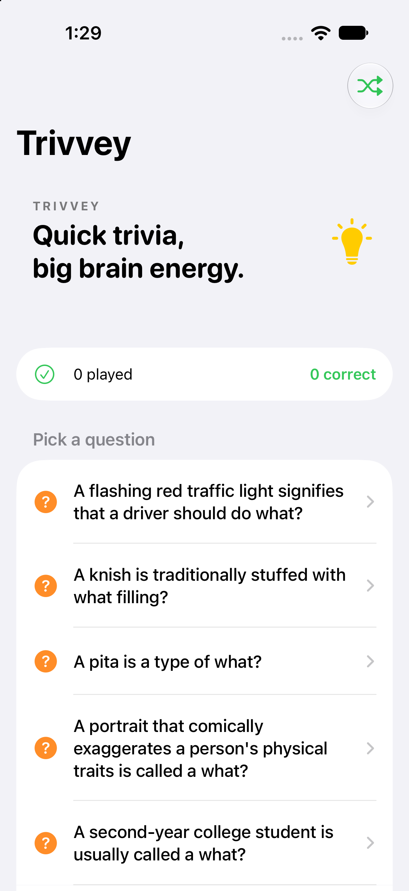

# Trivvey

A small SwiftUI trivia app for App Team Carolina iOS Bootcamp Project 5.

Trivvey loads trivia questions from a bundled JSON file, lets you open a question, choose an answer, and see your score. The question list can be shuffled.

## Built with

- SwiftUI views and navigation
- `@State` for the question list, play state, and score
- `@Binding` to update a question's answered state from its detail view
- `Codable` and `JSONDecoder` to load the bundled questions
- `ForEach` and reusable question views

## Run it

The questions are bundled in `Trivvey/questions.json`, so the app works without a network connection.

## Preview

Question data was supplied in the Project 5 starter materials: [questions.json](https://gist.github.com/cmota/f7919cd962a061126effb2d7118bec72).
